# EduBridge AI — The Learning Gap Detector
### *Uncovering WHY Students Struggle and Rebuilding Foundational Knowledge from the Roots*

[](LICENSE)
[](#)
[](#)
[-indigo)](#)

---

## 📌 The Real-World Problem
In rural and government schools across India, millions of students advance from one grade to the next with unrecognized learning gaps from earlier classes. When a Class 6 student struggles with **Adding Fractions with Unlike Denominators**, the typical approach is to repeat the Class 6 lesson over and over. However:
1. **The True Obstacle:** The student cannot grasp fractions because they never understood **Equal Parts** (Class 4) or **Least Common Multiple (LCM)** (Class 5).
2. **Teacher Bottleneck:** A single teacher managing 40–60 students lacks the hours needed to diagnose every child's historical prerequisite deficiencies.
3. **Language & Cultural Barrier:** Abstract textbook definitions fail to connect with students from agricultural and rural backgrounds.
4. **Connectivity Constraints:** High-bandwidth video platforms fail in low-network regions.

---

## 💡 The EduBridge AI Solution
**EduBridge AI** is an AI-powered educational diagnostic and remedial platform that discovers **WHY** a student struggles, pinpoints the earliest broken prerequisite node in the curricular knowledge graph, and builds a personalized recovery path using relatable rural stories in their native language (**Telugu, Hindi, and English**).

---

## 🌟 Core Features

### 1. ⚡ Smart Learning Gap Detector
- Short 3-to-4 question diagnostic assessments before teaching a chapter.
- Rather than just reporting a percentage score (e.g. "40%"), it isolates the exact conceptual misunderstanding (e.g. *Misconception: directly added numerators and denominators without finding a common denominator*).

### 2. 🌳 Root Cause Learning Tree *(Special Hackathon Flagship Feature)*
- An interactive, visual dependency map linking earlier grades (Class 4/5) to current syllabus topics (Class 6/7/8).
- Highlights the **exact root-cause node** with an animated pulsating alert (🔴).
- Clicking any node opens an inspection drawer with:
  - Prerequisite chain status
  - **Relatable Local Rural Analogy** (e.g., sharing a jowar roti, tractor irrigation pump cycles, vegetable market balance scale)
  - Audio narration button (`🔊 Listen`)
  - Direct practice launcher

### 3. 🤖 Multilingual AI Tutor with Speech (Voice & Text)
- Students can type or speak their doubts in **Telugu (తెలుగు)**, **Hindi (हिन्दी)**, or **English**.
- Powered by the Web Speech API (`SpeechRecognition` for voice queries, `SpeechSynthesis` for audio answers).
- Transparent AI integration:
  - Connects to **Google Gemini AI** when `GEMINI_API_KEY` is configured in `.env`.
  - Operates seamlessly on a built-in **Smart Educational Inference Engine** when offline or if no API key is provided (clearly labeled, no fake AI results).

### 4. 🛣️ Personalised Recovery Path
- Dynamically adapts based on the student's available daily study time (10 to 60 mins/day).
- Day-by-day roadmap:
  - **Day 1:** Root Cause Foundational Repair
  - **Day 2:** Connecting Bridge Concepts
  - **Day 3:** Target Chapter Problem-Solving
  - **Day 4:** Challenge Problems
- Gamified checklist with completion status and XP points.

### 5. 🌾 Learn Through Local & Cultural Examples
Abstract math and science explained through daily village life:
- **Fractions:** Slicing a round jowar/bhakri roti equally among siblings; dividing a sugarcane stick.
- **Least Common Multiple (LCM):** Two village borewell water pumps cycling at 4-hour and 6-hour intervals meeting at hour 12.
- **Linear Equations:** The grocer's two-pan weighing scale (*tarazu*) keeping weights level.
- **Photosynthesis:** A village kitchen where sunlight is the chulha fire, roots are drinking straws, and leaf pores are breathing mouths.

### 6. ✏️ Adaptive Practice with 3-Tier Hints & Mistake Breakdowns
- Non-judgmental learning environment.
- Progressive clues:
  - **Hint 1:** Real-life everyday clue.
  - **Hint 2:** Mathematical formula clue.
  - **Hint 3:** Worked-out step-by-step solution.
- Explains common traps (e.g., adding bottom numbers directly) and rewards learners with +20 XP.

### 7. 👩‍🏫 Teacher Intelligence Dashboard
- Class-wide learning gap heatmap and root cause distribution.
- Identifies that 62% of students struggling with Class 6 fractions actually have a Class 4 prerequisite gap.
- Provides a **Suggested 15-Minute Zero-Cost Classroom Remedial Activity** (using scrap notebook paper folding or tamarind seeds).
- Printable student remediation roster.

### 8. 📶 Low-Internet Mode & Offline PWA
- One-click Low-Internet toggle in the navigation header.
- Service Worker (`sw.js`) and LocalStorage cache ensure full functionality even with zero active internet connection.

### 9. ♿ Universal Accessibility
- Font size adjustments: `A-` (14px), `A` (16px), `A+` (18px/20px).
- High Contrast mode for visually impaired students.
- Audio read-aloud buttons on all questions, explanations, and analogies.

---

## 🛠️ Tech Stack & Architecture

- **Frontend:** HTML5, CSS3 (Custom Responsive Design System), JavaScript (ES6+ Modules, Web Speech API, Service Workers, SVG Tree Visualizations).
- **Backend:** Python 3 Standard Library HTTP & REST Server (Zero external `pip` dependencies required for instant execution!).
- **AI Engine:** Google Gemini REST API proxy + Built-in offline Multilingual Educational Knowledge Base.
- **Storage:** LocalStorage & server JSON persistence.

```
Hackthon/
├── server.py              # Lightweight Python HTTP & REST API server
├── run_server.bat         # One-click Windows runner
├── .env.example           # Environment template (GEMINI_API_KEY)
├── README.md              # Project documentation
└── public/
    ├── index.html         # Main single-page application
    ├── manifest.json      # PWA manifest
    ├── sw.js              # Offline caching service worker
    ├── css/
    │   ├── style.css      # Core styles, responsive design, dark/light
    │   ├── tree.css       # Visual Root Cause Tree & animations
    │   └── dashboard.css  # Quiz, tutor chat, teacher analytics & print styles
    └── js/
        ├── knowledgeData.js # Curricular dependency database (EN, TE, HI)
        ├── api.js           # Hybrid online/offline API client
        ├── diagnostic.js    # Diagnostic quiz & gap analysis
        ├── treeView.js      # Interactive Root Cause Learning Tree
        ├── tutor.js         # Multilingual speech tutor (mic + voice read)
        ├── practice.js      # Adaptive practice with 3-tier hints
        ├── recoveryPath.js  # Personalised recovery schedule generator
        ├── teacher.js       # Teacher dashboard & remedial activity planner
        ├── accessibility.js # Font scaling & contrast manager
        └── app.js           # Main application state orchestrator
```

---

## 🚀 Quick Start Guide

### Option 1: One-Click Windows Run
Double-click `run_server.bat` in the project root.

### Option 2: Command Line (Any OS with Python 3)
```powershell
py server.py 8000
```
Then open your browser at:
👉 **`http://localhost:8000`**

### Option 3: Optional Live Gemini AI Setup
1. Copy `.env.example` to `.env`:
   ```powershell
   Copy-Item .env.example .env
   ```
2. Open `.env` and paste your Gemini API key:
   ```env
   GEMINI_API_KEY=AIzaSy...
   ```
3. Restart the server. The header badge will update to **`✨ Google Gemini AI Connected`**.
*(Note: If no key is provided, EduBridge AI runs on its built-in Smart Educational Inference Engine with 100% functionality).*

---

## 🔄 User Workflow

```mermaid
flowchart LR
    A["Select Class & Subject"] --> B["Select Language (EN/TE/HI)"]
    B --> C["Take Diagnostic Quiz"]
    C --> D["Root Cause Gap Detected"]
    D --> E["Inspect Knowledge Tree"]
    E --> F["Learn via Rural Analogy"]
    F --> G["Adaptive Practice with Hints"]
    G --> H["Personalised Recovery Path"]
    H --> I["Teacher Dashboard Analytics"]
```


---

## 🏆 Hackathon Evaluation Summary
| Feature | Implementation Highlights |
|---|---|
| **Root Cause Detection** | Identifies earliest broken prerequisite in the knowledge chain instead of penalizing student on target lesson |
| **Interactive Tree** | Responsive SVG/DOM hierarchy with glowing pulse animation on broken foundational nodes |
| **Multilingual Voice** | Real speech synthesis & recognition supporting Telugu, Hindi, and English |
| **Cultural Relevance** | Local analogies (chapatis, borewells, tamarind seeds, neem trees, cotton harvests) |
| **Teacher Remediation** | 15-minute zero-cost classroom paper/seed activities for resource-limited schools |
| **Offline Resilience** | Full client-side fallback engine & Service Worker PWA for low-connectivity regions |
